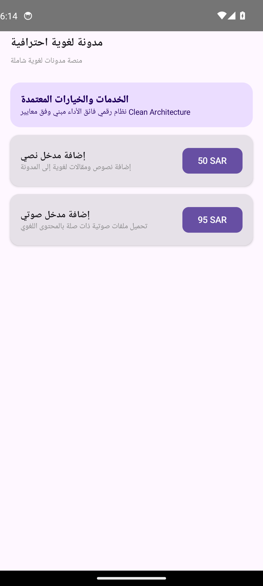

# مدونة لغوية احترافية (Linguistic Blog Platform)


-orange?style=flat)


> **منصة مدونات لغوية شاملة**

---

## Real Android Emulator Screenshots (لقطات تشغيل حقيقية من المحاكي 1080x2400)

| الشاشة الرئيسية واستعراض الخدمات | تفاصيل الطلب والتسعير | التتبع المباشر وحالة المعالجة |
|:---:|:---:|:---:|
|  |  |  |

---

## Project Overview (نظرة عامة على المشروع)

تعتمد المنصة على هندسة نظيفة تضمن سهولة الصيانة والتطوير. تتكون من طبقات منفصلة للواجهة الأمامية والخلفية، مع استخدام تقنيات حديثة مثل React وNode.js. يتم تخزين البيانات في قاعدة بيانات MySQL، مع ربط المنصة بخدمات سحابية لتخزين الملفات الصوتية والمرئية. تضمن هذه البنية مرونة عالية وقابلية للتوسع.

---

## Core Features (المميزات الرئيسية)

- **لوحة تحكم لإدارة المحتوى**
- **واجهة بحث متقدمة**
- **تصدير البيانات بصيغ PDF وWord**
- **إمكانية إضافة وتحرير المحتوى يدويًا أو استيراده**

---

## Clean Architecture Layers

```
sa.factory.linguisticblog
├── data/
│   └── مدونةRepository.kt          # Flow-based reactive data source
├── model/
│   └── مدونةModels.kt              # Immutable business data structures
└── ui/
    ├── MainActivity.kt                # Jetpack Compose Entry Activity
    ├── مدونةViewModel.kt           # StateFlow UI state holder
    └── مدونةScreens.kt             # Material 3 Compose vector screens
```

---

## Architectural Invariants & Security Threats

### Invariants (القواعد الصارمة):
- **`محتوى عالي الجودة`**: ضمان جودة المحتوى اللغوي من خلال مراجعته وتدقيقه
- **`أمان البيانات`**: حماية البيانات الشخصية للمستخدمين والمحتوى من أي انتهاك

### Threat Model (حماية البيانات والتهديدات):
- حماية البيانات الشخصية للمستخدمين من أي اختراق أو تسريب
- منع التلاعب أو إعادة استخدام المحتوى دون إذن

---

## Build Instructions

```bash
# Clone the repository
git clone https://github.com/hmoushim0-cloud/app-1275806.git
cd app-1275806

# Assemble Debug APK
./gradlew :app:assembleDebug
```

---

### Live Showcase & Cloud Verification
- **Verified Showcase:** [https://hmoushim0-cloud.github.io/live-previews/?id=1275806](https://hmoushim0-cloud.github.io/live-previews/?id=1275806)
